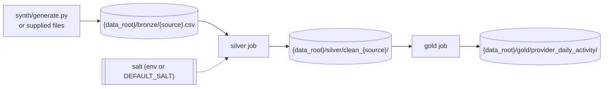
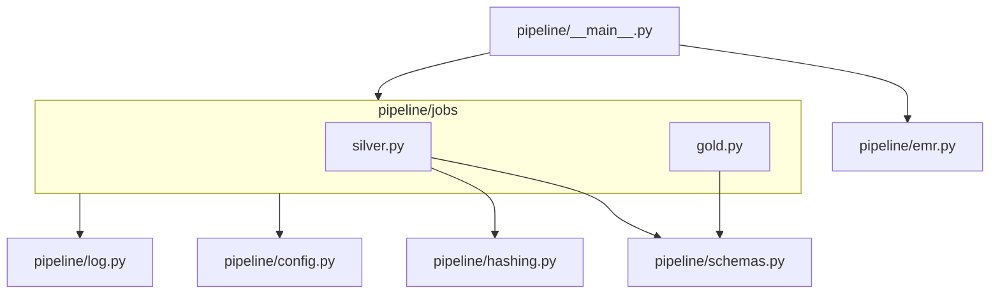

# Architecture Spine — Provider Daily Activity Pipeline

Revised 2026-10-14 by course correction (`sprint-change-proposal-2026-10-14.md`): the product changed from a patient history to provider daily activity. AD-1 to AD-7, AD-9 and AD-11 changed; AD-8 and AD-10 did not.

## Design Paradigm

**Medallion pipeline built as independent batch jobs** (pipes-and-filters, where storage is the pipe). Bronze is files, not a job. Each job reads only from storage, runs pure DataFrame transforms, and writes to storage. Jobs share code modules but never share state or call each other.





Jobs never import each other. Only `silver.py` imports `hashing.py`.

## Invariants & Rules

### AD-1 — Two jobs, one handoff through storage [ADOPTED, revised]

- **Binds:** all stories; CAP-1, CAP-2, CAP-4, CAP-5
- **Prevents:** layers coupling through in-memory DataFrames, which would make a layer impossible to run on its own as an EMR Step
- **Rule:** `pipeline/jobs/{silver,gold}.py` each expose `main(spark, conf)` plus an `if __name__ == "__main__"` entry, so an EMR Step can `spark-submit` each one with the package shipped via `--py-files` (absolute imports only). Silver's only input is bronze; gold's only input is silver. Bronze is written by `synth/generate.py` or supplied, never by a pipeline job.

### AD-2 — Storage contract [ADOPTED, revised]

- **Binds:** every read and write
- **Prevents:** jobs disagreeing on format, location or rerun behavior
- **Rule:**
  - Every layer is CSV with a header.
  - Bronze: `{data_root}/bronze/{source}.csv`. Silver: `{data_root}/silver/clean_{source}/`. Gold: `{data_root}/gold/provider_daily_activity/`.
  - Silver and gold writes use `mode("overwrite")` on their own folder, so reruns are idempotent. Timestamps are written in `TIMESTAMP_FORMAT`.
  - `data_root` is a local directory or an `s3://` prefix, and code never branches on which. Local `data_root` sits under a git-ignored path.

### AD-3 — Declared schemas in one module; only silver types [ADOPTED, revised]

- **Binds:** CAP-1, CAP-2, CAP-4; the day-of data swap
- **Prevents:** a job inferring or retyping a schema differently from the next job; stories typing the same field differently
- **Rule:**
  - `pipeline/schemas.py` holds `BRONZE_<SOURCE>` (all `StringType`), `CLEAN_<SOURCE>` and `GOLD_SCHEMA`, plus `TIMESTAMP_FORMAT`, `DEFAULT_SALT`, `SENTINELS` and `GOLD_SORT_KEYS`.
  - Every read uses `.schema(<declared>)`, `header=true`, `enforceSchema=false`, `multiLine=true` and CSV `mode=PERMISSIVE`. `inferSchema` is never used.
  - Silver types timestamps (one `parse_ts`), `result_value`, `active_flag` and `duration_days`; every other field stays a cleaned string.

### AD-4 — Silver derives everything, gold only joins and aggregates [ADOPTED, revised]

- **Binds:** CAP-2, CAP-3, CAP-4
- **Prevents:** the hash or duration being computed in two places; a raw patient ID reaching silver or gold; a crosswalk
- **Rule:**
  - Silver functions `silver_encounters`, `silver_labs`, `silver_providers`: clean, dedupe, drop rows missing required fields, derive `duration_days`, `hashedpatientid` and `partition_timestamp`, and set `patient_id` to null.
  - Gold joins silver tables and aggregates per data-model.md "Gold metrics"; it never reads bronze and never touches `patient_id`.
  - Encounters are reduced to one row per `(customer, encounter_id, provider_id)` before the lab join; `customer` is in every join, grouping and dedupe key.

### AD-5 — Every output passes through `conform_to` [ADOPTED, revised]

- **Binds:** CAP-2, CAP-4
- **Prevents:** hand-written selects drifting in column names, order or types, or letting an extra column through
- **Rule:** every silver and gold function returns `conform_to(df, <SCHEMA>)`: add any missing field as a typed null, select fields in schema order, cast each, drop everything else.

### AD-6 — One owner for patient-ID hashing [ADOPTED, revised]

- **Binds:** CAP-3; silver
- **Prevents:** two normalizations for one ID; IDs colliding across customers; PHI in a UDF traceback
- **Rule:**
  - `pipeline/hashing.py` owns `normalize_id` (Column expression: `(?U)\s` trim; lowercase), `make_hash_udf(salt)` and `with_hashed_patient(df, hash_udf)`.
  - The UDF computes HMAC-SHA256 over `customer + ":" + patient_id`, returns 64 lowercase hex characters, declares `StringType`, is built on the driver, returns null on null input, never raises on data, and doesn't use Arrow. It is the only Python UDF. The output column is `hashedpatientid`.

### AD-7 — Configuration checked once per process, before any work [ADOPTED, revised]

- **Binds:** CAP-3, CAP-5; every entry point
- **Prevents:** a job failing after starting work; the salt leaking through EMR or Spark surfaces
- **Rule:**
  - Only `pipeline/config.py` reads the environment: `DATA_ROOT` (required) and `PATIENT_ID_SALT` (optional; falls back to `DEFAULT_SALT` from `schemas.py`, the only allowed default secret, required by the interview prompt).
  - It produces an immutable `conf` whose `repr` masks the salt. Every job's `main` and the local orchestrator build `conf` before creating a SparkSession and raise if `DATA_ROOT` is missing.
  - The salt value never appears in EMR request payloads, Step `Args`, Spark conf, cluster configurations or logs.

### AD-8 — PHI-free observability [ADOPTED]

- **Binds:** CAP-2, CAP-7; story 3; all code
- **Prevents:** row values leaking through logs, prints or exception text
- **Rule:**
  - Transforms stay pure: DataFrame in, DataFrame out, no counters.
  - Each job's `main` logs, through `pipeline/log.py`, one line per source with `layer`, `source`, `rows_in`, `rows_out` and `dropped = rows_in - rows_out`.
  - Nothing calls `print`, `show` or `collect` for logging. Exceptions name columns and counts, never values.

### AD-9 — One command, two targets [ADOPTED, revised]

- **Binds:** CAP-5; stories 1 and 4
- **Prevents:** local runs and EMR runs executing different code paths
- **Rule:** `python -m pipeline run --target local|emr` is the only entry point.
  - **local:** runs `silver.main` then `gold.main` in one process with one SparkSession.
  - **emr:** `pipeline/emr.py` **prints** the `aws emr create-cluster` command for a transient EMR 7.14.0 cluster (single primary node, auto-terminate) with two Steps, silver → gold, each `spark-submit --deploy-mode cluster` of the same job entry point, with `ActionOnFailure=TERMINATE_CLUSTER`. No boto3.

### AD-10 — Runtime parity with EMR 7.14 [ADOPTED]

- **Binds:** all code; CAP-5
- **Rule:** local development and tests use exactly the Stack versions pinned in `pyproject.toml`; `JAVA_HOME` points to JDK 17; ruff `target-version = "py311"`. Only Spark 3.5 APIs; no pandas or pyarrow.

### AD-11 — Gold is ordered [ADOPTED, revised]

- **Binds:** CAP-4
- **Rule:** `GOLD_SORT_KEYS = customer, provider_id, encounter_date`. The pure `order_gold(df)` sorts by each with `asc_nulls_last()`; `gold.main` calls it last before writing. Readers that need order still sort, because Spark doesn't guarantee read order.

## Consistency Conventions

| Concern | Convention |
| --- | --- |
| Source names | `encounters`, `labs`, `providers`: bronze file `{source}.csv`, silver table `clean_{source}`, schema constants `BRONZE_<SOURCE>` / `CLEAN_<SOURCE>` |
| Columns and rules | Exactly as `data-model.md` (schemas, silver rules, hashing, gold metrics) |
| Invalid rows | Rows missing a required field are dropped and counted via AD-8, never fixed in place or quarantined with values |
| Transforms | Pure functions named `<layer>_<source>` (e.g. `silver_labs`), plus `gold_provider_daily_activity`; I/O only in each job's `main` |
| Spark error surfaces | CSV `PERMISSIVE`, ANSI mode off, `timeParserPolicy=CORRECTED`, no `FAILFAST` |
| Tests | pytest with one session-scoped local SparkSession. Chained in-memory dummy datasets per layer (bronze → expected `clean_*` → expected gold); every output checked with `assert_schema` and `assert_content` from `tests/assertions.py`; plus the required tests in `data-model.md` |
| Data | `synth/generate.py` writes `{data_root}/bronze/{source}.csv` with a fixed seed and every quality issue. Supplied data is never copied into tests, fixtures or `synth/` |
| Delivery | Stories are a steel thread; cut from story 4 upward. Story 1 and the PHI review are never cut |

## Stack

| Name | Version |
| --- | --- |
| Apache Spark / PySpark | 3.5.8 (`pyspark==3.5.8`; EMR 7.14.0 ships 3.5.8-amzn-0) |
| Python | 3.11 |
| Java | 17 (Corretto 17 on EMR 7.14.0) |
| Amazon EMR on EC2 | 7.14.0 |
| pytest | 9.1.1 |
| ruff | 0.17.0 |

## Structural Seed

```text
pipeline/
  __main__.py      # run --target local|emr (AD-9)
  config.py        # env -> conf, fail fast, masked salt (AD-7)
  schemas.py       # StructTypes, constants, sentinels (AD-3)
  hashing.py       # normalize_id + make_hash_udf (AD-6)
  log.py           # counts-only logging (AD-8)
  emr.py           # prints create-cluster command with 2 Steps (AD-9)
  jobs/
    silver.py      # main + silver_<source> + conform_to (AD-4, AD-5)
    gold.py        # main + gold_provider_daily_activity + order_gold (AD-4, AD-11)
synth/
  generate.py      # bronze CSVs
tests/
  assertions.py    # assert_schema, assert_content
pyproject.toml     # pinned Stack (AD-10)
```

## Capability → Architecture Map

| Capability / Area | Lives in | Governed by |
| --- | --- | --- |
| CAP-1 bronze CSV | `synth/generate.py`, `schemas.py` | AD-2, AD-3 |
| CAP-2 silver clean_* | `jobs/silver.py` | AD-3, AD-4, AD-5, AD-8 |
| CAP-3 patient-ID hashing | `hashing.py`, `config.py` | AD-6, AD-7 |
| CAP-4 gold provider activity | `jobs/gold.py` | AD-4, AD-5, AD-11 |
| CAP-5 one command, EMR | `__main__.py`, `emr.py` | AD-9, AD-10 |
| CAP-6 synthetic data and dummy datasets | `synth/generate.py`, `tests/` | AD-3, data and test conventions |
| CAP-7 PHI review | `_bmad/custom/phi-review-lens.md` | AD-4, AD-6, AD-7, AD-8 |

## Deferred

- **How the salt reaches the job on EMR** (Secrets Manager plus what the Step receives): decided in story 4, within AD-7.
- **AWS environment details:** placeholders in the printed command.
- **Security Rule controls:** care-team-only access, read audit logging, KMS encryption at rest and TLS in transit, the AWS BAA and a HIPAA-eligible EMR configuration. Named, not built; they apply to every layer and to EMR logs.
- **Replacing the public `DEFAULT_SALT`:** a salted hash of small integer IDs with a known salt can be brute-forced; production keeps the salt secret.
- **Atomic layer writes, a data-quality framework, partitioning and CI:** not needed at interview scale.
