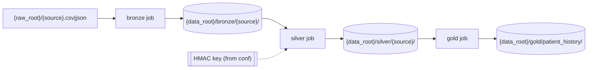
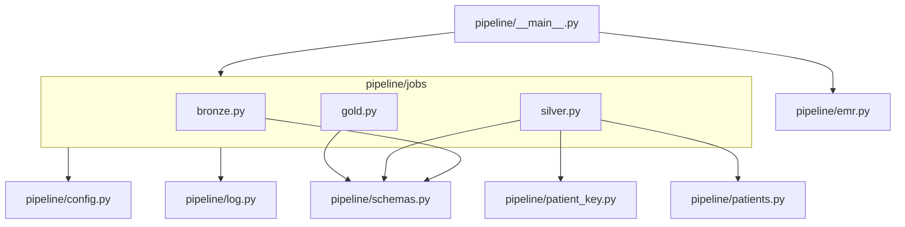
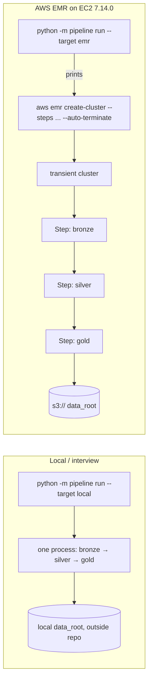

# Architecture Spine — Patient History Pipeline

## Design Paradigm

**Medallion pipeline built as three independent batch jobs** (pipes-and-filters, where storage is the pipe). Each job reads only from storage, runs pure DataFrame transforms, and writes to storage. Jobs share code modules but never share state or call each other.



Module dependency direction is a rule (AD-1, AD-4, AD-6):



Jobs never import each other. Only `silver.py` imports `patient_key.py` and `patients.py`.

## Invariants & Rules

### AD-1 — Three jobs, one handoff through storage [ADOPTED]

- **Binds:** all stories; CAP-1, CAP-2, CAP-4, CAP-5
- **Prevents:** layers coupling through in-memory DataFrames, which would make a layer impossible to run on its own as an EMR Step
- **Rule:** `pipeline/jobs/{bronze,silver,gold}.py` each expose `main(spark, conf)` plus an `if __name__ == "__main__"` entry, so an EMR Step can `spark-submit` each one with the package shipped via `--py-files` (absolute imports only). A job's only input is the upstream layer in storage (bronze: `{raw_root}`), and its only output is its own layer.

### AD-2 — Storage contract [ADOPTED]

- **Binds:** every read and write in every job
- **Prevents:** jobs disagreeing on format, location or rerun behavior
- **Rule:**
  - Layers are plain Parquet.
  - Bronze and silver live at `{data_root}/{layer}/{source}/`. Gold is a single dataset at `{data_root}/gold/patient_history/`.
  - Every write uses `mode("overwrite")` on its own folder, so reruns are idempotent.
  - `data_root` is a local directory or an `s3://` prefix, and code never branches on which.
  - Local `data_root` and `raw_root` sit outside the repo or under a git-ignored path.

### AD-3 — Declared schemas in one module; only silver types [ADOPTED]

- **Binds:** CAP-1, CAP-2, CAP-4; the day-of schema swap
- **Prevents:** a job inferring or retyping a schema differently from the next job; bronze silently nulling bad values so silver can't count them; stories typing the same field differently
- **Rule:**
  - `pipeline/schemas.py` holds, per source, one `RAW_<SOURCE>` `StructType` (all `StringType`, used for both raw read and bronze) and its input format (`csv` default, `json` allowed). It also holds `SILVER_<SOURCE>`, `GOLD_SCHEMA` and the single `DATE_FORMAT`.
  - Reads use `.schema(<declared>)` and CSV `mode=PERMISSIVE`. `inferSchema` is never used.
  - In silver, only dates (via one `parse_date`) and `age_at_encounter` change type; every other field stays a trimmed string.
  - The day-of swap edits `schemas.py` and the affected per-source functions only.

### AD-4 — Silver derives everything, gold derives nothing [ADOPTED]

- **Binds:** CAP-2, CAP-3, CAP-4; stories 1–4
- **Prevents:** age, ZIP3 or the key being computed in two places or two ways; gold adding an identifier back; a stored MRN-to-key crosswalk
- **Rule:**
  - `silver/patients` is the only dataset that holds direct identifiers. It **never** holds `patient_key_v1`, and it has one row per normalized `(facility, mrn)`; duplicates are dropped.
  - Each silver event function:
    1. normalizes its own `facility` and `mrn`, then applies `drop_invalid_identity` (silver/patients does the same before deduplicating);
    2. from story 2, calls `attach_patient(events, patients, date_col)` in `pipeline/patients.py`, the only owner of the inner join, `age_at_encounter` (whole years, 90 for ages over 89), `sex`, `state` and `zip3`;
    3. calls `with_patient_key(df, key_udf)`;
    4. drops `facility`, `mrn` and every patient field other than those four.
  - Events with no matching patient are dropped.
  - Gold only selects, renames, unions and casts.

### AD-5 — Every gold source passes through `conform_to_gold` [ADOPTED]

- **Binds:** CAP-4; stories 1–4
- **Prevents:** hand-written per-source gold functions drifting in column names, order or types, or letting a forbidden column through
- **Rule:** every per-source gold function returns `conform_to_gold(df)`. It adds any missing `GOLD_SCHEMA` field as a typed null, then selects the fields in order, casts each one and drops everything else. Before story 2, for example, the demographics are null. The gold job unions only conformed DataFrames (`unionByName`).

### AD-6 — One owner for the patient key [ADOPTED]

- **Binds:** CAP-3; silver in stories 1–4
- **Prevents:** join input and hash input being normalized differently (one patient, two keys); blank MRNs merging many patients into one key; the key read on executors; PHI in a UDF traceback
- **Rule:**
  - `pipeline/patient_key.py` owns these Column expressions (not UDFs):
    - `normalize_facility`: strip surrounding whitespace (regex `\s`, since Spark's `trim` only removes ASCII spaces), uppercase.
    - `normalize_mrn`: remove all whitespace, then strip leading zeros (`^0+`).
    - `drop_invalid_identity(df)`: drops rows whose normalized facility or MRN is null or empty.
  - It also owns `make_key_udf(secret)`: an HMAC-SHA256 UDF over `facility + ":" + mrn` that returns 64 lowercase hex characters.
    - The UDF is built on the driver, capturing `secret` from `conf`.
    - It declares `StringType` explicitly.
    - It returns null on null input, never raises on data, and doesn't use Arrow.
  - It is the only Python UDF. The output column is `patient_key_v1`.
  - A row whose normalized facility or MRN is empty (for example an MRN of `0000` or blank) is invalid. `drop_invalid_identity` removes it from patients and events before the join, so blank MRNs never share one key or merge patients. The drop is counted only through AD-8's `dropped`.

### AD-7 — Configuration checked once per process, before any work [ADOPTED]

- **Binds:** CAP-3, CAP-5; every entry point
- **Prevents:** a job failing after starting work; a default key; the key value leaking through EMR or Spark surfaces
- **Rule:**
  - Only `pipeline/config.py` reads the environment: `DATA_ROOT`, `RAW_ROOT`, `PATIENT_KEY_HMAC_SECRET`.
  - It produces an immutable `conf` whose `repr` masks the key.
  - Every job's `main` and the local orchestrator build `conf` before creating a SparkSession, and they raise if any variable is missing. The key is required even for bronze. Nothing has a default.
  - `--target emr` needs no key value locally.
  - The key value never appears in EMR request payloads, Step `Args`, Spark conf, cluster configurations or logs. How the key reaches the job on EMR is decided in story 6 within this rule.

### AD-8 — PHI-free observability [ADOPTED]

- **Binds:** CAP-2, CAP-7; story 5; all code
- **Prevents:** row values leaking through logs, prints or exception text; stories counting drops differently
- **Rule:**
  - Transforms stay pure: DataFrame in, DataFrame out, no counters.
  - Each job's `main` logs, through `pipeline/log.py`, one line per source with `layer`, `source`, `rows_in`, `rows_out` and `dropped = rows_in - rows_out`. That count covers invalid rows, duplicate patients and orphan events.
  - Nothing calls `print`, `show` or `collect` for logging. Exceptions name columns and counts, never values.

### AD-9 — One command, two targets [ADOPTED]

- **Binds:** CAP-5; stories 1 and 6
- **Prevents:** local runs and EMR runs executing different code paths
- **Rule:** `python -m pipeline run --target local|emr` is the only entry point.
  - **local:** runs `bronze.main`, `silver.main` and `gold.main` in order, in one process with one SparkSession.
  - **emr:** `pipeline/emr.py` **prints** the `aws emr create-cluster` command for a transient EMR 7.14.0 cluster (single primary node, auto-terminate). The command has three Steps: bronze → silver → gold, each `spark-submit --deploy-mode cluster` of the same job entry point, with `ActionOnFailure=TERMINATE_CLUSTER`. There is no boto3 and no other orchestrator.

### AD-10 — Runtime parity with EMR 7.14 [ADOPTED]

- **Binds:** all code; CAP-5
- **Prevents:** code that passes locally but fails on EMR
- **Rule:**
  - Local development and tests use exactly the Stack versions, pinned in `pyproject.toml`. `JAVA_HOME` points to JDK 17, and ruff uses `target-version = "py311"`.
  - Only Spark 3.5 APIs are used. pandas and pyarrow are not used.

### AD-11 — Gold is in time order [ADOPTED]

- **Binds:** CAP-4; stories 1, 3, 4
- **Prevents:** a doctor seeing a patient's events out of date order; stories sorting differently or not at all
- **Rule:**
  - `schemas.py` defines `GOLD_SORT_KEYS = patient_key_v1, event_date, event_type, event_code`.
  - The pure function `order_gold(df)` in `gold.py` sorts by each key with `asc_nulls_last()`. `gold.main` calls it last, after the union, before writing.
  - The time-order test calls `order_gold` on a shuffled synthetic DataFrame and checks that the sort keys in `collect()` never decrease. It never reads Parquet back.
  - Each Parquet file keeps its write order, but Spark doesn't guarantee row order when it reads a multi-file dataset (splits are scheduled by size). Any reader that needs the order, the demo included, sorts by `GOLD_SORT_KEYS`.

## Consistency Conventions

| Concern | Convention |
| --- | --- |
| Source names | Plural snake_case: `patients`, `encounters`, `labs`, `diagnoses`, `medications`. The same string is used for the raw file name, the layer folder and the schema constant suffix |
| `event_type` values | Singular lowercase: `encounter`, `lab`, `diagnosis`, `medication` |
| Gold columns and types | `patient_key_v1`, `event_type`, `event_code`, `event_value`, `event_unit`, `encounter_id`, `sex`, `state` and `zip3` are strings (`zip3` = first 3 characters of the 5-digit ZIP string; `event_value` is free text and is never logged). `event_date` and `event_end_date` (nullable) are dates. `age_at_encounter` is an int. `encounter_id` is kept on purpose, for linking events within a visit |
| Event mapping into gold | **encounter:** date=`encounter_date`, end=`discharge_date`, code=`encounter_type` · **lab:** date=`result_date`, code=`test_code`, value=`result_value`, unit=`unit` · **diagnosis:** date=`diagnosis_date`, code=`icd10_code` · **medication:** date=`start_date`, end=`end_date`, code=`drug_code`, value=`dose`. Unmapped fields are null |
| Invalid rows | Each silver per-source function sets its own validity rules. A missing or unparseable required date is always invalid. Invalid rows are dropped, never fixed in place or quarantined with values |
| Transforms | Pure functions named `<layer>_<source>` (e.g. `silver_labs`); I/O happens only in each job's `main` |
| Spark error surfaces | CSV `PERMISSIVE`, ANSI mode off, and no `FAILFAST`, so Spark's own error text can't carry row values |
| Tests | pytest with one session-scoped local SparkSession fixture; transforms tested on in-memory synthetic DataFrames. Required: exact `GOLD_SCHEMA`, no forbidden column, gold rows in time order via `order_gold` (AD-11), a blank, whitespace-only or all-zero MRN is dropped and never shares a key, `SILVER_PATIENTS` has no key field, key determinism and 64-hex format, missing env var fails fast, age 90+ and ZIP3, `dropped` counts |
| Data | `synth/generate.py` writes `{raw_root}/{source}.csv` with a fixed seed, matching `RAW_<SOURCE>`. Data supplied on the day is read only through `raw_root` and never copied into tests, fixtures or `synth/` |
| Delivery | Stories are a steel thread; cut from story 6 upward under time pressure. Story 1 and the PHI review are never cut (runbook) |

## Stack

| Name | Version |
| --- | --- |
| Apache Spark / PySpark | 3.5.8 (`pyspark==3.5.8`; EMR 7.14.0 ships 3.5.8-amzn-0) |
| Python | 3.11 |
| Java | 17 (Corretto 17 on EMR 7.14.0) |
| Amazon EMR on EC2 | 7.14.0 |
| pytest | 9.1.1 |
| ruff | 0.17.0 |

## Structural Seed

```text
pipeline/
  __main__.py      # run --target local|emr (AD-9)
  config.py        # env -> conf, fail fast, masked key (AD-7)
  schemas.py       # StructTypes, input formats, DATE_FORMAT (AD-3)
  patient_key.py   # normalize_* + make_key_udf (AD-6)
  patients.py      # attach_patient: join, age, zip3 (AD-4)
  log.py           # counts-only logging (AD-8)
  emr.py           # prints create-cluster command with 3 Steps (AD-9)
  jobs/
    bronze.py      # main + bronze_<source>
    silver.py      # main + silver_<source>
    gold.py        # main + gold_<source> + conform_to_gold (AD-5)
synth/
  generate.py      # synthetic raw CSVs
tests/
pyproject.toml     # pinned Stack (AD-10)
```



## Capability → Architecture Map

| Capability / Area | Lives in | Governed by |
| --- | --- | --- |
| CAP-1 bronze ingest | `jobs/bronze.py`, `schemas.py` | AD-1, AD-2, AD-3 |
| CAP-2 silver clean + age | `jobs/silver.py`, `patients.py` | AD-3, AD-4, AD-8 |
| CAP-3 patient key | `patient_key.py`, `config.py` | AD-6, AD-7 |
| CAP-4 gold history | `jobs/gold.py` | AD-4, AD-5, AD-11, gold conventions |
| CAP-5 one command, EMR | `__main__.py`, `emr.py` | AD-9, AD-10 |
| CAP-6 synthetic data | `synth/generate.py` | AD-3, data convention |
| CAP-7 PHI review | `_bmad/custom/phi-review-lens.md` | AD-4, AD-5, AD-7, AD-8 |

## Deferred

- **How the key reaches the job on EMR** (Secrets Manager plus what the Step receives): decided in story 6, within AD-7's rule that the value never appears in payloads, args, conf or logs.
- **AWS environment details:** S3 buckets and prefixes, code-zip upload location, IAM roles, VPC, region and instance sizing. These are placeholders in the printed command until a real account is used.
- **Security Rule controls:** care-team-only access, read audit logging, KMS encryption (SSE-KMS) at rest and TLS in transit, the AWS BAA and a HIPAA-eligible EMR configuration. Named here, not built in this scope. They apply to **every layer** (bronze and `silver/patients` hold the most sensitive fields) **and** to the EMR `LogUri` bucket and Spark event logs, which are treated as PHI.
- **Key rotation to `patient_key_v2`:** the column version carries it; the procedure waits until rotation is needed.
- **Drop-rate failure threshold and key scope:** whether a job fails when too many rows are dropped (it would use AD-8 counts only), and whether only silver checks the key (AD-7 currently checks it in every job). Raised in review, not decided.
- **Per-source validity rules beyond required dates:** set by each story after the day-of data review.
- **Partitioning, performance tuning, a data-quality framework and CI:** not needed at interview scale.
